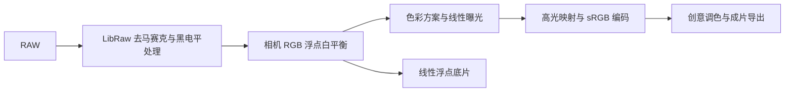

<div align="center">

# IR Studio Pro

**让红外 RAW 的白平衡、假色与高光调整更自由。**

为全波段改机和近红外摄影准备的本地 RAW 工作台，特别适合探索 590 nm 假色。

[快速开始](#快速开始) · [色彩方案](#色彩方案) · [调色与导出](#调色与导出) · [原理和边界](#原理和边界) · [参考与许可](#参考与许可)


</div>

---

## 为什么做这个工具？

改机相机搭配红外滤镜时，普通色温滑块可能无法到达想要的白平衡。IR Studio Pro 直接使用 RAW 相机通道，允许分别设置 R、B 白平衡倍率，并提供几种红外假色起点。照片由本机处理；打开浏览器只是访问本机界面。

| 白平衡与光影 | 调色与交付 |
| --- | --- |
| 吸管框选中性区域，R/B 倍率可输入 `0.0001–10000` | 粉红、红色、橙色及经典通道互换方案 |
| 浮点曝光与高光压缩，预览直方图和传感器饱和统计 | 冷暖色饱和度、色相、明暗和附加通道互换 |
| 缩略预览，支持多张照片独立调整 | 导出 JPG、16 位成片 TIFF 或 32 位浮点底片 TIFF |

## 快速开始

1. 将项目放在 **E 盘**。当前 Windows 版本将临时文件、缓存及导出位置限定在 E 盘。
2. 安装 Python，并确认 `python` 命令可用。首次使用双击 **`安装环境.bat`**；它会创建项目内的 `.venv` 并通过 pip 安装 `requirements.txt` 中的依赖，首次安装需要网络。
3. 双击 **`启动红外白平衡.bat`**，在自动打开的本地页面中拖入 RAW。如果浏览器没有自动打开，使用窗口显示的地址。
4. 用吸管框选照片中应为中性的白墙或灰路，选择色彩方案，再调整曝光与饱和度。导出前可选择 E 盘已有文件夹。

> 这是创意假色工作流。取白位置、相机改机方式、滤镜和光线都会改变结果；树叶、天空或道路不会被自动识别为不同物体。

## 色彩方案

在现有的 **色彩方案** 下拉菜单中切换，无须更改界面布局。以下名称描述的是风格方向，而非对每张照片的结果保证。

| 方案 | 适合尝试的方向 | 方法 |
| --- | --- | --- |
| **珊瑚粉红 · 深影** | 珊瑚粉植被、深色阴影 | 柔红矩阵加创意调色，参考照片的风格而非原片配方 |
| **粉红树叶 · 柔和** | 粉红、珊瑚色植被 | 改编自 590 nm 柔红树叶通道矩阵 |
| **红色树叶 · 鲜明** | 红棕或暖红植被 | 改编自 590 nm 红树叶通道矩阵 |
| **橙色树叶 · 暖调** | 金黄至橙色植被 | 改编自 590 nm 橙树叶通道矩阵 |
| **粉红假色 · 三通道循环** | 粉紫树叶等实验效果 | 线性相机通道 `R←B，G←R，B←G` |
| **公开 590 预设矩阵** | 金黄植被等假色 | 改编自 590 nm 黄树叶通道矩阵 |
| **线性红蓝互换** | 经典假色起点 | 线性相机通道 `R↔B` |
| 相机矩阵 / 原始通道 / 旧版蓝金 | 比较不同处理方式 | 保留已有方案 |

矩阵方案使用相机色彩矩阵作为输入基准，并对公开矩阵按行归一化以保持中性灰；原预设的白平衡、曲线等模块没有完整移植。因此结果与 RawTherapee 原预设不同，可继续使用白平衡、曝光、色相及冷暖饱和度微调。

## 调色与导出

- **白平衡**：R 和 B 滑块围绕当前数值细调，也可以直接输入倍率；重新取白后，必要时点击自动曝光。
- **直方图**：反映处理后预览的亮度分布。传感器饱和信息单独显示，不能从预览直方图推断原始通道是否饱和。
- **冷暖色调整**：按颜色范围调整，并不识别具体物体；例如降低暖色饱和可能同时影响道路和树叶。
- **JPG 与成片 TIFF**：包含当前调色，嵌入 sRGB 色彩配置。每次导出会附带参数 JSON。
- **浮点底片 TIFF**：线性相机 RGB，包含白平衡、自动曝光基准和曝光 EV，保留高于 1 的数值；不包含成片色彩方案及显示曲线，也不是 DNG。

项目内 `output` 是默认输出目录；界面可指定 E 盘已有文件夹。上传 RAW 的临时会话副本位于 `output/.cache`；正常退出服务时删除，异常退出后可能需要手动清理。

常用快捷键：按住 <kbd>\</kbd> 临时查看未调色画面；<kbd>W</kbd> 切换吸管；<kbd>←</kbd> / <kbd>→</kbd> 切换照片。双击参数滑块或标签可恢复默认值。

也可以从项目目录通过命令行查看 RAW、取白及导出：

```powershell
.venv\Scripts\python.exe -B ir_wb.py info "E:\照片\sample.ARW"
.venv\Scripts\python.exe -B ir_wb.py solve "E:\照片\sample.ARW" --region 0.2,0.3,0.5,0.6
.venv\Scripts\python.exe -B ir_wb.py apply "E:\照片\sample.ARW" --mul 0.4,1,2.3 --out "E:\照片\result.tif"
```

## 原理和边界



高光软压缩尽量保留可用的亮部层次，但无法恢复传感器已经饱和的信息。可见光相机矩阵并非针对改机和红外滤镜的实测标定。不同材料可能呈现相近假色，需要结合实际照片调整。

支持范围取决于 LibRaw 能否解码所用 RAW；目前针对三色 RGB 传感器。手机独立版的代码在 [`android/`](android/README.txt)，**本次新增方案属于 Windows 版，尚未同步到安卓安装包**。

## 参考与许可

- 黄、柔红、红、橙色矩阵改编自 [anxix / rt_ir_presets](https://github.com/anxix/rt_ir_presets)，原作者按 **CC BY-SA 4.0** 共享。原始参考文件、来源和许可见 [`research/590nm`](research/590nm)。
- 三通道循环的处理思路参考 [Hidden Realms 的 Aerochrome 后期教程](https://hiddenrealms.ch/aerochrome-postprocess/)。这里使用的是线性相机通道，并非完整复现教程的滤镜和后期流程。
- RAW 解码使用 [rawpy](https://github.com/letmaik/rawpy) 与 [LibRaw](https://www.libraw.org/)；各依赖的许可见其项目。安卓组件许可另见 [`android/LICENSE`](android/LICENSE)。

<div align="center"><sub>Made for curious infrared photographers.</sub></div>
