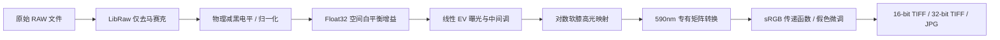

<div align="center">

# 📷 IR Studio Pro
### 高精度红外 RAW 白平衡与创意调色矩阵工作台

[](https://github.com/yigeshenhouhouhou/infrared_raw/stargazers)
[](https://www.python.org/)
[](https://letmaik.github.io/rawpy/)
[](https://github.com/anxix/rt_ir_presets)
[](https://creativecommons.org/licenses/by-sa/4.0/)

<p align="center">
  <b>突破商用软件色温限制 · 32-bit 浮点物理白平衡 · 590nm 专有矩阵 · 影室级暗黑工作台</b>
</p>

[✨ 核心亮点](#-核心亮点) • [⚡ 快速上手](#-快速上手) • [⌨️ 快捷操作](#️-快捷操作) • [🔬 科学管线原理](#-科学管线原理) • [💻 命令行示例](#-命令行批处理)

</div>

---

## 📖 项目简介

常规修图软件（如 Adobe Lightroom / Photoshop）在导入**改机红外相机 RAW（尤其是 590nm 全波段）**时，由于内置色彩矩阵强制基于可见光日光（D65）标定，通常会导致以下痛点：
1. **白平衡滑块触顶截断**：红外强烈的通道反差常要求 $R/G$ 或 $B/G$ 达到极端倍率，商用软件的色温滑块往往直接失效或偏红/偏蓝失真；
2. **高光死白硬剪裁**：过早截断至 16-bit 导致天空或树木的高光细节丢失；
3. **缺乏专有矩阵转换**：只能依靠手动画笔或粗糙的通道互换，色彩还原不够干净。

**IR Studio Pro** 专为红外摄影与科研图像设计。全流程在 **32-bit Float 线性相机空间** 中进行物理减黑电平、中性灰吸管求解与动态曝光映射，并搭载 **DaVinci / Capture One 级别** 的沉浸式专业暗黑调色工作台。

---

## ✨ 核心亮点

<table>
  <tr>
    <td width="50%">
      <h3 align="center">🧮 32-bit 纯浮点高光保留管线</h3>
      <ul>
        <li><b>0.0001 ~ 10000 自由白平衡</b>：突破商业软件倍率限制，精确解算中性灰。</li>
        <li><b>对数软膝高光压缩</b>：曝光与对比度调整后实施软过渡，杜绝高光死白硬裁切。</li>
        <li><b>传感器物理饱和监控</b>：区分显示白色与硬件光电过曝，准确掌握动态范围。</li>
      </ul>
    </td>
    <td width="50%">
      <h3 align="center">🎨 590nm 专有假色色彩方案</h3>
      <ul>
        <li><b>公开 590 预设矩阵</b>：经行归一化标定，直出梦幻金黄树木与湛蓝天空。</li>
        <li><b>多模式色彩混色</b>：线性红蓝互换 (R↔B)、红绿互换、RGB 旋转及旧版蓝金。</li>
        <li><b>双通道饱和微调</b>：冷色明度/饱和与暖色独立解耦微调。</li>
      </ul>
    </td>
  </tr>
  <tr>
    <td width="50%">
      <h3 align="center">🖥️ 影室暗黑调色工作台</h3>
      <ul>
        <li><b>中性纯黑影室界面</b>：消除白光对色彩校准和人眼的视觉干扰。</li>
        <li><b>RGB 对数重叠直方图</b>：三原色半透明曲线叠加，暗部与高光一目了然。</li>
        <li><b>胶卷卡片批处理</b>：直观缩略图、CFA 阵列、拍摄分辨率实时显示。</li>
      </ul>
    </td>
    <td width="50%">
      <h3 align="center">📦 灵活的导出规格</h3>
      <ul>
        <li><b>16-bit 成片 TIFF</b>：完整嵌入 sRGB ICC 色彩配置与全部调色曲线。</li>
        <li><b>32-bit 浮点底片 TIFF</b>：保留超出 1.0 的超白数据，供科研与 HDR 二次处理。</li>
        <li><b>一键快速存 JPG</b>：原图尺寸、95 质量、4:4:4 色度采样快速成片。</li>
      </ul>
    </td>
  </tr>
</table>

---

## ⚡ 快速上手

### 1. 环境准备
项目自带离线独立环境，开箱即用：
```bash
# 首次运行或搬移目录后执行（配置 LibRaw 与 Python 依赖）
双击运行 "安装环境.bat"
```

### 2. 启动本地工作台
```bash
# 启动本地工作室
双击运行 "启动红外白平衡.bat"
```
服务启动后将自动在默认浏览器中打开 `http://127.0.0.1:8765/`。所有 RAW 像素运算与预览均在本地完成，**无需上传网络，保障数据绝对隐私与高速解码**。

---

## ⌨️ 快捷操作指南

为专业修图与科研工作流定制的高频键盘映射：

| 快捷键 | 对应动作 | 功能解析 |
| :---: | :--- | :--- |
| <kbd>\</kbd> 或 <kbd>|</kbd> | **瞬时对比原片 (Hold)** | **按住**切换查看未调色 RAW 原片，**松开**瞬间回到当前调色状态 |
| <kbd>W</kbd> | **吸管测白 (Eyedropper)** | 开启/关闭十字准心，在画面拖动框选公路、白墙等中性灰区域取白 |
| <kbd>←</kbd> / <kbd>→</kbd> 或 <kbd>[</kbd> / <kbd>]</kbd> | **胶卷切换 (Switch)** | 快速切换到胶卷批次中的上一张 / 下一张 RAW 照片 |
| **双击滑块 / 标签** | **参数复位 (Reset)** | 任意参数滑块或标题双击，立即精准恢复初始默认值 |
| **单击数值** | **直接输入 (Input)** | 白平衡增益及参数支持键盘精准手输数值，按回车立即生效 |

---

## 🔬 科学管线原理



* **原始传感层保护**：LibRaw 关闭全部自动增益、可见光色彩转换及默认 AWB，杜绝前期数据损失；
* **真物理动态压缩**：在高光拐点采用多项式对数肩部曲线，保留全部通道比例，避免红外色彩翻转时的色阶断层。

---

## 💻 命令行批处理

除了图形工作台外，底层引擎支持直接在终端无头调用：

```bash
# 1. 探查 RAW 物理元数据、CFA 阵列与直方图基准
.venv\Scripts\python.exe -B ir_wb.py info "E:\Photos\demo.ARW"

# 2. 对指定归一化矩形区域 (x0, y0, x1, y1) 求解中性灰白平衡乘数
.venv\Scripts\python.exe -B ir_wb.py solve "E:\Photos\demo.ARW" --region 0.2,0.3,0.5,0.6

# 3. 批量将白平衡系数与曝光应用并输出 16-bit 成片
.venv\Scripts\python.exe -B ir_wb.py apply "E:\Photos\demo.ARW" --mul 0.45,1.0,2.15 --out "E:\Photos\export.tif"

# 4. 输出科研级 32-bit 浮点线性底片 (保留超白 HDR 亮部数据)
.venv\Scripts\python.exe -B ir_wb.py apply "E:\Photos\demo.ARW" --mul 0.45,1.0,2.15 --linear --out "E:\Photos\linear.tif"
```

---

## 📁 项目目录结构

```text
infrared_raw/
├── ui/
│   └── index.html               # 专业 DaVinci / Capture One 质感影室调色工作台前端
├── ir_wb.py                     # 核心浮点色彩科学管线、白平衡求解与矩阵变换算法
├── ir_wb_gui.py                 # 本地多线程 HTTP 引擎与实时渲染网关
├── raw_backend.py               # LibRaw / rawpy 底层物理去马赛克与多线程解算封装
├── choose_export_folder.py      # 原生 Windows 导出文件夹选择器
├── research/
│   └── 590nm/                   # 590nm 专有红外矩阵算法原型与校准标定记录
├── 启动红外白平衡.bat            # 一键启动本地服务脚本
└── 安装环境.bat                 # 自动化离线依赖配置脚本
```

---

## 📜 开源协议与致谢

* **色彩矩阵参考**：色彩混色与红外矩阵算法改编自 [anxix/rt_ir_presets](https://github.com/anxix/rt_ir_presets)（遵循 **CC BY-SA 4.0** 协议）。
* **解码驱动**：底层基于开源 [LibRaw](https://www.libraw.org/) 与 [rawpy](https://github.com/letmaik/rawpy)。
* 本项目采用 **CC BY-SA 4.0** 许可证开放，欢迎科研与摄影爱好者共同交流演进！

<div align="center">
  <sub>Crafted with passion for Infrared Photography & Color Science.</sub>
</div>
